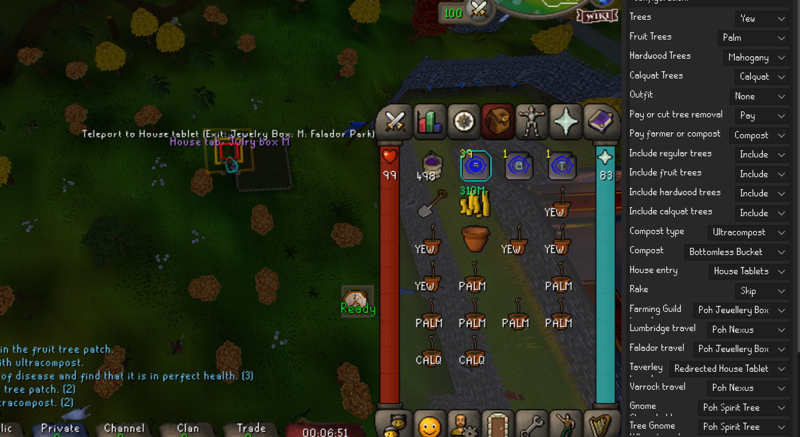
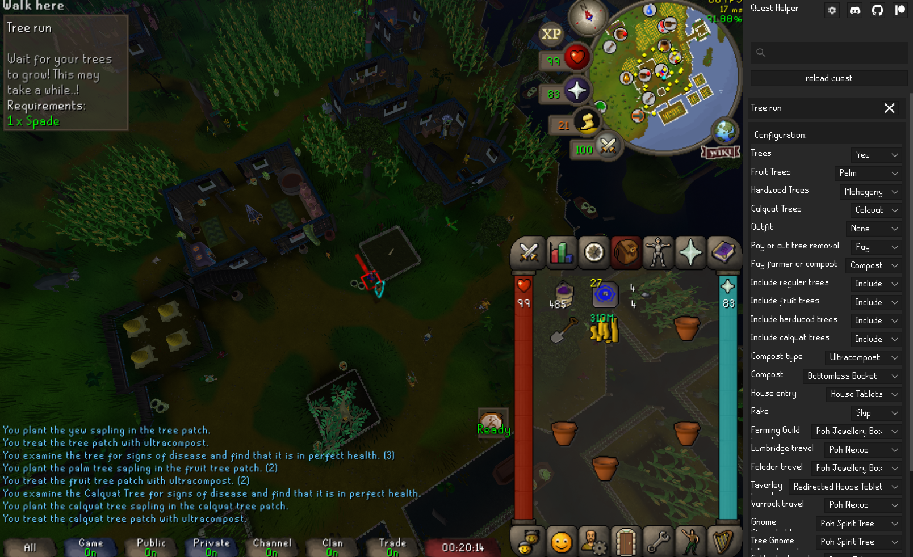

# Tree-run gameplay feedback — 27 October 2026

The user tested PR #2879 at commit `4f97671a7585c35f4b8bf5b33df9172080ae2b6c` in the game.
These are the original screenshots supplied by the tester, published with their permission.
They document the prior build; they are not evidence of gameplay testing the follow-up fixes.

## Settings during the run

Yew, palm and mahogany trees; calquat enabled; paid removal; ultracompost;
bottomless bucket; rake skipped; selected POH travel methods.

## End of the run

The helper reaches “Wait for your trees to grow”. The chat shows planting and
ultracompost messages. This demonstrates progression through the tested run;
it does not establish that every route or setting has been exercised.

## Feedback addressed by the follow-up

- Keep walking between nearby patches, including both Gnome Stronghold patches.
- Remember observed Nexus hotkeys in the current RS profile; invalidate them when
  opening the Nexus configuration and relearn from the next teleport menu.
- Add the Taverley-to-Catherby rocks route (68 Agility, barehanded).
- Prevent Shortest Path from replacing selected arrival instructions with its own
  POH route. The farm helper requests walking-only paths once near the destination;
  until then its selected transport instructions remain in the Quest Helper panel.
- Include the CKR-to-calquat walk in local arrival detection.

The follow-up changes have automated regression coverage; gameplay testing of
those changes remains pending. No claim that the assistant played the game is made.
